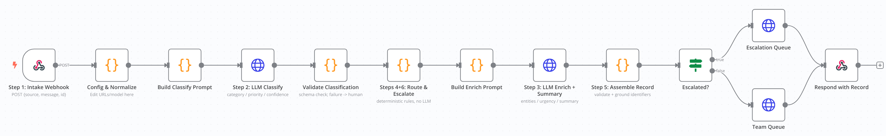
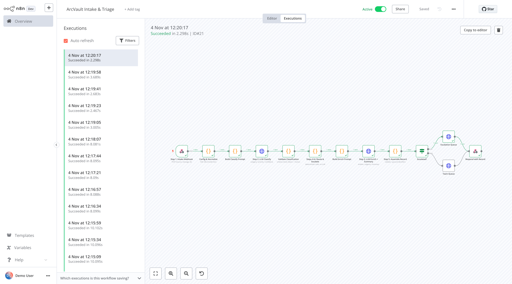

# ArcVault Intake & Triage: Architecture Write-Up



## 1. System design

```
 Email / Web form / Portal
          │  POST {source, message, id}
          ▼
 [1] Intake webhook ──202 Accepted──▶ caller        (record_id = hash(source|message))
          │  in-memory work queue → worker threads
          ▼
 [2] LLM: classify ──▶ validate (+1 repair retry) ──▶ category · priority · confidence
          ▼
 [4+6] Deterministic rules ──▶ intended queue, escalation flag + reasons
          ▼
 [3] LLM: enrich + team summary ──▶ validate ──▶ ground identifiers against the raw text
          ▼
 [5] Assemble record ──▶ records.jsonl (source of truth) ──▶ queues/<queue>.jsonl
                                                         ──▶ records.json / .csv snapshot
                                                         ──▶ optional downstream webhook
```

**Two equivalent implementations, one set of prompts.**
- The **Python service** (`intake_server.py`, standard library only) is the reference implementation. It has unit tests and an evaluation harness.
- The **n8n workflow** (`n8n/arcvault_triage_workflow.json`) is the visual version requested in the brief. It is generated from the same `prompts.py` and mirrors the same routing rules, so both produce the same record IDs and schema.
- I tested the n8n workflow end to end in a local n8n 1.80 instance.

**Triggers.**
- An HTTP webhook starts the workflow on every new message. Any channel (email parser, form, portal) just POSTs to it.
- The Python service returns `202` immediately and processes the message on a worker thread, so a slow LLM never times out the sender.

**Where state lives.**
- `output/records.jsonl` is the append-only log and the source of truth.
- Each queue gets its own file, which is what each team consumes.
- A JSON/CSV snapshot is rebuilt for humans.
- Idempotency: `record_id` is a hash of source plus message, so a re-delivered message is detected and skipped instead of creating a duplicate ticket.
- The n8n version holds state in the execution itself and delivers records to two downstream webhooks: team queues and escalation.

**Model.** `openai/gpt-oss-120b` on **Groq's free tier**. I chose it because it:
- is free and fast (about 2–3 s per message for both calls);
- supports JSON mode;
- has open weights, so a company with data-residency concerns could self-host the same model later without changing the prompts.

I first wrote the pipeline for Llama 3.3 70B. On the first real run, Groq returned `model_not_found`, because that model had been retired from the free tier. I switched models with one config value. That's a small, real argument for keeping the client provider-agnostic: OpenAI, Gemini or a local Ollama model is one environment variable away.

**Results.**
- On the 5 samples: **5/5 correct** on category, priority, queue, escalation and required identifiers, in both the Python and n8n versions (`output/eval_report.md`).
- On the 3 extra edge cases (`output/edge_cases/`):
  - The prompt-injection attempt was ignored and escalated correctly.
  - The $3,000 billing error was escalated.
  - The vague multi-request message ("the thing isn't working + send me an invoice") is a **known weakness**. It scored 0.78 confidence, just above the 0.70 bar, so it routed to Engineering, and the invoice request reached the wrong team. Phase 2 item 5 addresses this.

**Known limitation: confidence calibration.** The model reports 0.96–0.97 for almost everything, even when it names a runner-up category. Self-reported confidence is close to useless as a probability. The 0.70 rule still catches vague messages, but I wouldn't trust it as the only safety net. That's why the keyword and category escalation rules exist independently, and why measured confidence is the second item in Phase 2.



## 2. Routing logic

| Category | Queue | Why |
|---|---|---|
| Bug Report | Engineering | Needs a code fix; engineering owns the defect backlog |
| Incident/Outage | Engineering On-Call | Needs immediate response, not a backlog slot |
| Feature Request | Product | Product managers own prioritisation of new capabilities |
| Billing Issue | Billing | Finance has the invoice/contract system access |
| Technical Question | Technical Support | How-to and "is X supported" questions; often pre-sales (e.g. the Okta SSO evaluation) |

**Routing is plain code, not an LLM decision.** The model proposes labels; a lookup table decides the destination. This makes routing:
- **auditable** (every record shows `intended_queue` and why it moved);
- **testable** (12 unit tests, no API calls);
- **changeable by operations** without touching prompts.

## 3. Escalation logic

A record goes to **Human Escalation** if **any** of the following rules fire. Every rule that fires is listed in `escalation_reasons`. The record keeps its `intended_queue`, so the reviewer can confirm it with one click.

1. **Confidence < 0.70** (the brief's threshold). The model is unsure, so a human checks before the ticket lands in the wrong queue, which is the exact problem ArcVault has today.
2. **Category = Incident/Outage.** Outages need a human incident owner, status-page updates and customer comms. Automation should page people, not replace them.
3. **Keyword rules, applied to the raw text.** These run independently of the model, so a misclassified outage is still caught. Patterns: `outage`, `is/went down`, `down for all`, `multiple/several/all users`, security words (`breach`, `compromised`, `unauthorized access`), and legal words (`lawsuit`, `chargeback`). I used word-boundary regexes, not substring matching, to avoid false positives like "down" in "download".
4. **Billing error > $500.** *Assumption:* "error" means the **disputed difference**, not the invoice total. Sample 3 (charged $1,240 against a $980 rate) is a **$260** error, so it routes to Billing without escalation. Under the other reading (invoice total > $500) it would escalate. The threshold and the interpretation are one line to change, and I would confirm the business intent with ArcVault.
5. **Processing failure.** Invalid LLM output after one repair attempt, or an API failure, fails *safe*: the message goes to a human and is never silently dropped or guessed.

Expected result on the five samples:
- Sample 5 (dashboard down, multiple users) is escalated for two independent reasons: the category and the keyword rule.
- Samples 1–3 go to their teams.
- Sample 4 (Okta SSO) is the most ambiguous message ("not sure if this is the right place"), so whether it escalates depends on the model's confidence. That is the intended behaviour.

## 4. What I'd change at production scale

- **Rate limits.** This hit me for real during testing. Groq's free tier allows 8,000 tokens/minute, and two parallel workers tripped it. The client now honours the server's `Retry-After` / "try again in 4.4s" hint, with jitter. A message that still fails is stored with its error and can be re-sent: only *successful* records count as duplicates. In production, add a token-bucket rate limiter in front of the LLM client and a paid tier with higher limits.
- **Reliability.** Replace the in-memory queue with a durable one (SQS, Redis Streams or Pub/Sub) with a dead-letter queue, so messages survive restarts. Store records in Postgres rather than files.
- **Delivery.** Write to real ticketing tools (Jira, Zendesk) with retries and an idempotency key equal to `record_id`.
- **Cost.**
  - Classification is the high-volume, easy call: use a small, fast model (8B-class) for it. Call the 70B model, or a frontier model, only when confidence is low.
  - Cache by `record_id`.
  - Batch the non-urgent categories.
  - At Groq or gpt-4o-mini prices, two calls per ticket costs fractions of a cent.
- **Latency.** Run enrichment in parallel with routing where the summary doesn't need the queue. Use provider structured outputs to remove repair round trips. Set per-call timeouts and use a circuit breaker that routes everything to humans if the LLM provider is down.
- **Quality and observability.**
  - Log the prompt version, model, latency and the human reviewer's final decision for every record.
  - That decision log becomes a labelled dataset: track per-category precision, calibrate the confidence threshold, and alert on drift.
  - Gate prompt changes in CI on `eval/evaluate.py` run over a larger golden set.
- **Security.** Mask personal data before LLM calls if required, keep API keys in a secret manager, and red-team prompt injection (see `edge-3`).

## 5. Phase 2 (another week)

1. **A human-in-the-loop UI** for the escalation queue: approve or override in one click, with every override feeding back into an eval set and few-shot examples.
2. **Measured confidence**: self-consistency (N samples) or logprob-based scores instead of self-reported confidence, calibrated on real ticket history.
3. **Context enrichment through tools/RAG**: look up the account (plan, ARR, open tickets), the invoice against the contract, and the status page. This lets priority reflect customer value, and lets an outage report attach to an existing incident instead of creating 50 duplicate tickets.
4. **Deduplication and clustering** of near-identical reports (several customers reporting the same dashboard outage become one incident).
5. **Multi-intent splitting**: one email containing a bug *and* a billing question becomes two linked records (see `edge-1`).
6. **Drafted first responses** for Technical Questions, grounded in ArcVault's docs, sent to an agent for approval.
